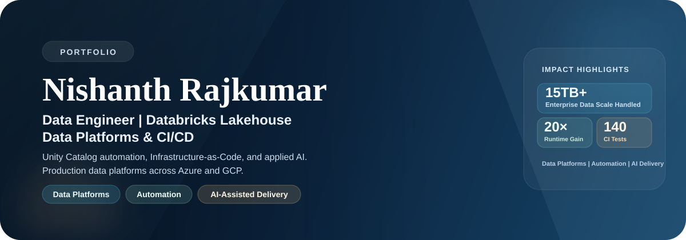

  

  
  
  
  

---

### Snapshot

I build production Databricks Lakehouse platforms — Unity Catalog automation, metadata-driven ingestion, Infrastructure-as-Code CI/CD, and privacy-preserving AI — across Azure and GCP.

My core focus areas:
- Databricks Lakehouse, Unity Catalog governance, and Delta Lake
- CI/CD and Infrastructure-as-Code for data platforms (Asset Bundles, Azure DevOps)
- Metadata-driven ETL/ELT, CDC, and near-real-time ingestion
- Applied AI in pipelines (PII masking, LLM classification) and AI-assisted engineering

### Featured Initiative

**Customer Service Hub — a production Databricks Lakehouse, deployed as code**

Built and operate the Lakehouse at Ashley that consolidates voice, chat, order-event, case, and customer master data into Unity Catalog for operational reporting, AI-driven interaction classification, and PII-safe analytics.

- **CI/CD as code.** 4-stage Azure DevOps pipeline (Validate → Dev → Stage → Prod) deploying Databricks Asset Bundles with per-environment service principals and approval gates. A Python bundle generator enforces naming, catches duplicates and missing notebooks at build time, and applies job permissions consistently. Reusable templates cut the pipeline from **1,042 to 228 lines**.
- **Schema reconciliation engine.** Diffs version-controlled DDL against the live Unity Catalog, auto-applies safe changes (new columns, type widening), and routes destructive or ambiguous drift to a conditional review gate that blocks only in Production. Backed by **140 pytest tests** and six CI-enforced DDL rules.
- **Ingestion & AI.** **6 production Databricks Workflows** using metadata-driven, watermark-based ingestion; Azure Service Bus → Auto Loader every 15 minutes; GPU PII masking (XLM-RoBERTa Large + Microsoft Presidio) followed by `AI_CLASSIFY` interaction categorisation.

> Stack: Databricks · Unity Catalog · Delta Lake · Asset Bundles · Auto Loader · PySpark · Azure DevOps · Azure Service Bus · pytest · Presidio · AI_CLASSIFY

**Also at Ashley — AI-integrated BigQuery SDLC.** Exported BigQuery into a Git repo via `INFORMATION_SCHEMA`, wrote RFC-2119 standards for AI coding agents, and built a human-gated PR → change-script → owner-deployment workflow. Representative delivery dropped from **~5 days to 1–2 days**, and other Ashley teams now use it as the reference pattern.

### At A Glance

| Area | Summary |
|---|---|
| Role Focus | Databricks Lakehouse, Data Platforms & CI/CD |
| Core Platforms | Databricks, Azure, GCP |
| Data Scale | 15TB+ enterprise workloads |
| Delivery Impact | 20× runtime gain, 140 automated tests, 6 production workflows, 11 POCs, 22 improvements |

### Currently Building

- Hardening the Unity Catalog reconciliation engine and reviewed change-script path
- A vendor-agnostic customer-service data model ready for conversational-AI sources
- Metadata-driven delivery patterns for repeatable platform work

### Databricks Expertise

- Unity Catalog governance and automated schema evolution across Dev / Stage / Prod
- Databricks Asset Bundles, Workflows, and Infrastructure-as-Code deployment
- Auto Loader and metadata-driven, watermark-based ingestion into Delta Lake
- GPU and LLM enrichment inside pipelines (Presidio, XLM-RoBERTa, `AI_CLASSIFY`)

### Signature Wins

| Metric | Outcome |
|---|---|
| 20× | Encrypted-file processing runtime: ~4 hours → ~10 minutes |
| 140 | Automated pytest tests running in CI/CD |
| 78% | Smaller deployment pipeline (1,042 → 228 lines) |
| 15TB+ | Enterprise data scale handled |

  Recognized with the Dirty Fingernail Award (2025) and Above and Beyond Award of the Quarter (Q4 2025).

### Featured Work

**[TripAdvisor-Reviews-Analysis-AZURE](https://github.com/NishanthRajkumar/TripAdvisor-Reviews-Analysis-AZURE)**  
Problem: Build a robust sentiment-analysis pipeline with analytics-ready outputs.  
Built: Azure solution using Synapse Analytics, Data Lake, Data Warehouse, Power BI, and Azure ML.  
Stack: Synapse | Data Lake | Data Warehouse | Power BI | Azure ML

**[Azure-RealTime-Twitter-Data](https://github.com/NishanthRajkumar/Azure-RealTime-Twitter-Data)**  
Problem: Capture and process social signals in near real time.  
Built: Streaming workflow using Python, Azure Functions, Event Hub, and Stream Analytics.  
Stack: Python | Azure Functions | Event Hub | Stream Analytics

**[CosmosDB-BooksLibrary-API](https://github.com/NishanthRajkumar/CosmosDB-BooksLibrary-API)**  
Problem: Deliver a practical API with cloud-native data persistence patterns.  
Built: Python service with Cosmos DB-backed data operations.  
Stack: Python | API Design | Cosmos DB

> Additional enterprise platform work is available on request where code is private or team-owned.

### Case Highlights

- Pipeline Reliability Upgrade
Problem: Cross-platform data flow had preventable operational friction.
Action: Standardized integration patterns and reliability-focused pipeline design.
Outcome: Enabled high-volume delivery at 15TB+ enterprise data scale.

- AI-Assisted Delivery Enablement
Problem: Data engineering lagged other teams in adopting AI safely.
Action: Built repo-first SDLCs for BigQuery and Databricks, with AI-agent rules files (naming, secrets, catalog conventions) and human PR gates.
Outcome: Representative BigQuery changes went from ~5 days to 1–2 days; the pattern was extended to the Databricks platform.

- Continuous Improvement Drive
Problem: Multiple delivery bottlenecks reduced throughput.
Action: Targeted process and automation enhancements across delivery lifecycle.
Outcome: Implemented 22 measurable process improvements and exceeded POC targets by 11.

### Tech Stack

**Databricks:** Lakehouse, Unity Catalog, Delta Lake, Asset Bundles, Auto Loader, Workflows, AI_CLASSIFY  
**Cloud and Data:** Azure (ADF, Synapse, Service Bus, Functions, Logic Apps, DevOps), GCP (BigQuery, Cloud Run Jobs, Cloud Workflows, Dataflow), Microsoft Fabric  
**Languages and Runtime:** Python, PySpark, SQL, C#, .NET, KQL, YAML, Bash  
**Engineering and Delivery:** Infrastructure-as-Code, pytest, Web APIs, Hangfire, Power BI, Presidio, Agile/Scrum

### Engineering Principles

- Reliability first: build for failure handling, retries, and observability
- Business aligned: prioritize measurable impact and maintainable systems
- Fast iteration: use AI-assisted workflows while keeping quality gates clear

### Now And Next
Operating and extending a production Databricks Lakehouse with Unity Catalog automation and CI/CD
**Now:** Building robust cross-cloud data pipelines with Databricks-enabled engineering patterns.  
**Next:** Solving larger platform-scale data and integration challenges with measurable business impact.

### GitHub Signals

### Currently Exploring

Agentic engineering workflows, metadata-driven pipelines, and practical patterns for AI-enabled data operations.

### What I Can Help With

- Building and productionizing Databricks Lakehouse platforms on Unity Catalog
- CI/CD and Infrastructure-as-Code for data platforms, including automated schema evolution
- Scalable cloud data pipelines and CDC across GCP and Azure
- Improving delivery velocity through automation and AI-assisted workflows

### Open To

Data Engineering and Cloud Data Platform roles focused on integration-heavy, high-impact delivery.

### Reach Me

[Website](https://nishanthrajkumar.me) | [Email](mailto:nishrk97@outlook.com) | [LinkedIn](https://www.linkedin.com/in/nishanthrajkumar) | [GitHub](https://github.com/NishanthRajkumar)
